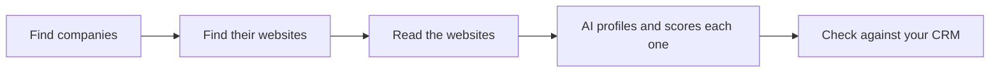

# Lead Gen: AI lead research

**Tell it what you sell. Get a list of local companies likely to buy it.**

**[Try the demo](https://lead-gen-orpin.vercel.app/)** (no sign-up, nothing to install)

For each company you get:

- what they do, in one sentence
- a fit score from 0 to 100, with the reason
- a draft opening line for a cold email
- whether they're already in your CRM

## An example

Searching for customers for **EV charge points**, the top lead was a vehicle hire firm:

> **Score: 92.** A vehicle hire firm with two branches, running a fleet of cars and vans and offering MOT and servicing.
>
> **Opener:** "Your Blyth and Bedlington branches run a self-drive car and van fleet alongside MOT and servicing work, so vehicles are moving through your sites every day."

## How it works



1. **Find companies** from Companies House, the official UK register. This demo covers small companies in the North East of England.
2. **Find their websites** with a web search, and check each site really belongs to the company.
3. **Read each website**: the homepage and about page.
4. **Profile and score each company** with an AI model (Claude), against a plain-English description of your ideal customer.
5. **Check against your CRM**, so you only get companies you don't already have. New leads are exported as a file ready to import into HubSpot.

## What the demo run found

- Of 200 small companies sampled, **55 had a website** that was verifiably theirs. Most small companies don't have one.
- **35 were new leads**; the other 20 were already in the (synthetic) CRM.
- The AI caught wrong website matches that simple rules missed, such as a US company with a similar name.
- AI costs are about **$0.54 per 1,000 companies** profiled.

## Data and privacy

- **Company-level public data only:** Companies House records and each company's own public website.
- **No personal data:** no names, emails or phone numbers of individuals, and no LinkedIn. Emails and phone numbers are removed from website text before it is stored. This keeps it simple under UK GDPR.
- **Polite scraping:** it respects robots.txt, waits between requests and identifies itself.
- **Synthetic CRM:** the CRM data used for matching is made up.

---

## For developers

Built with Python, httpx, BeautifulSoup, DuckDB, Pydantic, Claude Haiku 5.5 and Next.js.

<details>
<summary><b>Run it yourself</b></summary>

You need a Companies House API key, a Serper.dev key (web search) and an Anthropic API key.

```bash
conda create -n leadgen python=3.12
conda activate leadgen
pip install -r requirements.txt
cp .env.example .env   # then add your API keys
```

Each stage runs on its own and can be re-run safely; it only processes companies that don't have a result yet.

```bash
python -m lead_gen.db                # create the database
python -m lead_gen.find_companies    # 1. find companies
python -m lead_gen.find_websites     # 2. find websites
python -m lead_gen.scrape            # 3. read the websites
python -m lead_gen.enrich            # 4a. AI profile
python -m lead_gen.score             # 4b. AI fit score and opener
python -m lead_gen.synthetic_crm     # 5a. generate the synthetic CRM export
python -m lead_gen.crm_clean         # 5b. clean, de-duplicate and match
python -m lead_gen.hubspot_export    # 5c. HubSpot-ready CSV of new leads
python -m lead_gen.export_dashboard  # data snapshot for the web demo
```

To run the web demo locally, see [web/README.md](web/README.md).

</details>

<details>
<summary><b>How the AI is used</b></summary>

- The model never browses or searches. It only reads text the pipeline has already collected.
- Every answer must match a fixed Pydantic schema before it is stored.
- It is told to use only what the website says, and to leave a field empty rather than guess.
- Scoring reads the short profile, not the whole website, which keeps it cheap.
- Every call is cached and logged with its token count and cost, and prompts are versioned.
- Answers were checked against 25 hand-labelled companies: see [eval/results.md](eval/results.md).

</details>

<details>
<summary><b>Repository layout</b></summary>

```
lead_gen/          one Python module per pipeline stage, plus config, db and shared helpers
web/               the Next.js demo site
eval/              labelling sheet and evaluation reports
docs/findings.md   notes and numbers from every stage
```

The customer descriptions used for scoring are in `CUSTOMER_DESCRIPTIONS` in [lead_gen/config.py](lead_gen/config.py).

</details>
